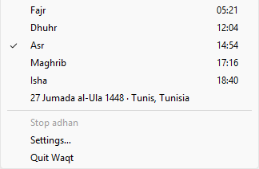

# Waqt

Prayer time countdown in your Windows tray. Works offline.

Waqt sits in the notification area and shows the minutes left to the next prayer, notifies you at each prayer with an optional adhan, and turns the Maghrib countdown into an iftar countdown during Ramadan. After you set your city once it uses no network at all.



## Install

1. Download `Waqt-setup.exe` from the [latest release](https://github.com/seifsg/waqt/releases/latest).
2. Run it. It installs for your user only, so no admin rights are needed. The installer is not code-signed yet, so Windows SmartScreen may ask you to confirm ("More info", then "Run anyway").
3. Waqt opens its settings once: search your city (171,806 places, offline) or type your coordinates, pick your calculation method and Asr time, and save.

Windows 11 puts new tray icons in the overflow (the ^ arrow). Drag Waqt's icon onto the taskbar to keep the countdown visible.

## Run from source

Needs [Rust](https://rustup.rs) (stable, MSVC toolchain on Windows), Node.js 20.19+ or 22.12+, and the WebView2 runtime (built into Windows 11).

```bash
npm ci
npm run tauri dev      # run the app with live reload of the settings window
npm run tauri build    # build the installer into src-tauri/target/release/bundle/nsis
```

Other commands:

| Command | Does |
|---|---|
| `npm test` | Prayer-time tests against published timetables (Umm al-Qura, MUIS Singapore, Kuwait) |
| `npm run typecheck` | Strict TypeScript check of the settings window, landing page and scripts |
| `npm run build` | Builds the landing page into `dist/` |
| `npm run cities -- <folder>` | Rebuilds `ui/public/cities.tsv` from GeoNames `cities1000.txt` and `admin1CodesASCII.txt` |

## Use

| Where | What you get |
|---|---|
| Tray badge | Minutes left; gold in the last 15; hours on night blue when the next prayer is far |
| Hover | The prayer, time left and its clock time |
| Right-click or click | Today's five times, the next one ticked, the Hijri date, Stop adhan, Settings, Quit |
| At prayer time | A notification, and the adhan if it is on for that prayer |
| In Ramadan | Maghrib reads "Iftar"; Umm al-Qura adds its 30 extra minutes to Isha |

Settings: 12 calculation methods, Standard or Hanafi Asr, a Hijri date adjustment of up to two days for local moon sighting, adhan per prayer with volume, and Start with Windows. Above 65° latitude, where the sun may not set or rise, times use the nearest latitude where they exist.

## Privacy and footprint

- No account, no analytics, no network: prayer times are computed on your PC, and Waqt opens no sockets.
- About 13 MB of memory and no measurable CPU while it waits; it wakes at each minute and each prayer.
- Your settings live in `%APPDATA%\dev.seif.waqt\config.json`.

## Releases

Pushing a tag such as `v0.1.0` (matching the version in `src-tauri/tauri.conf.json`) builds the installer and attaches it to that tag's GitHub Release as `Waqt-setup.exe`. Pull requests build it as a downloadable artifact.

## Credits

Prayer-time math by [salah](https://github.com/insha/salah), a Rust port of Batoul Apps' [Adhan](https://github.com/batoulapps/adhan-js). Place data © [GeoNames](https://www.geonames.org/) (CC BY 4.0). Adhan recording: CC0, Wikimedia Commons. Full list in [CREDITS.md](CREDITS.md).

🏭 Built with [AI Software Factory](https://softwarefactory.company/) by Seif
